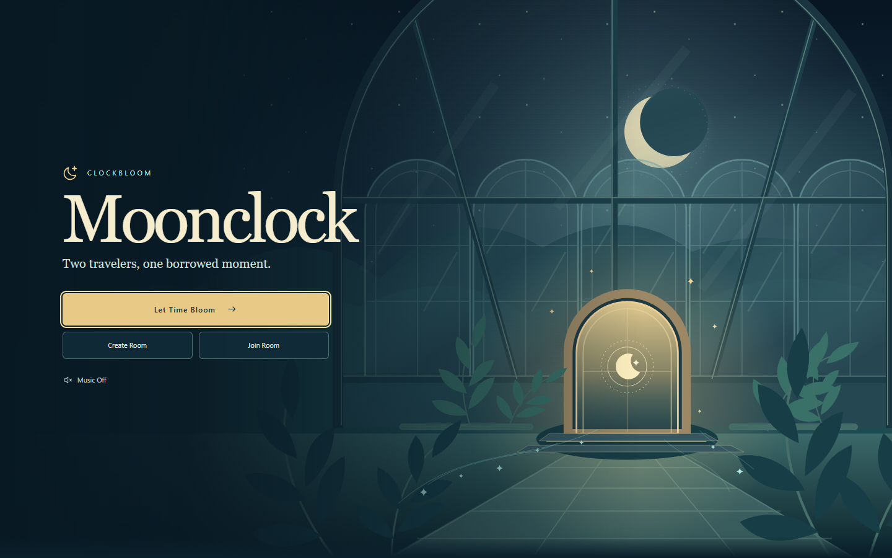
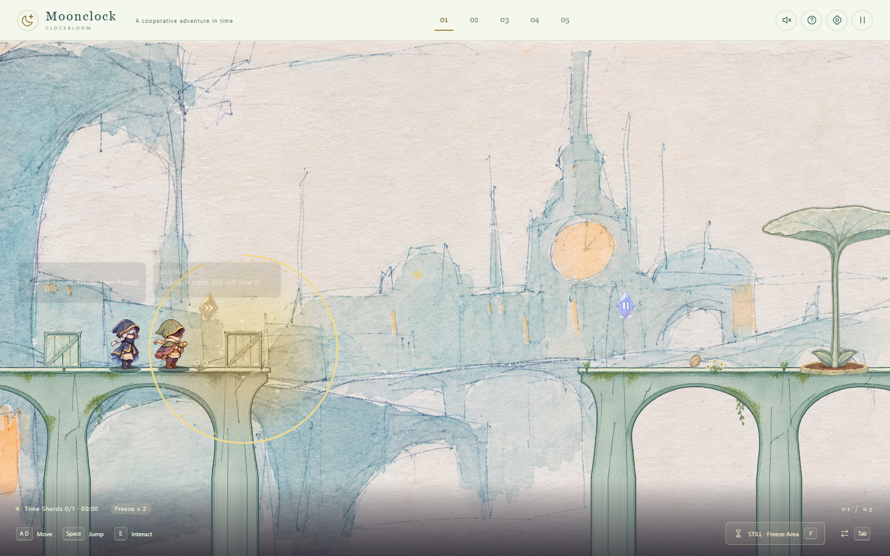
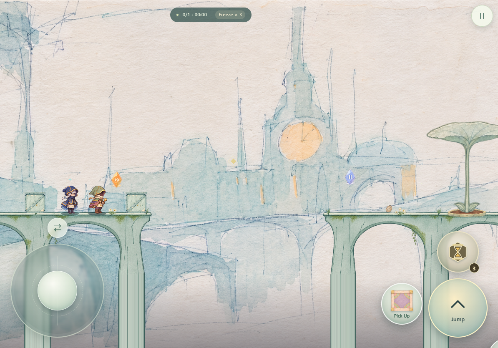

# Moonclock

> Two travelers, one borrowed moment.

Moonclock 是一款时间协作平台解谜游戏。两位旅人穿过钟塔、断桥与空中庭院，用不同的时间能力改变眼前的世界，寻找通往月门的道路。

## 两位旅人，两种时间能力

| 角色 | 能力 |
| --- | --- |
| **Still** | 施放缓时领域，让物体与机关放慢，并定住成形的云，为跳跃、落脚和通过危险创造机会。 |
| **Bloom** | 唤醒物体的时间，逐次加速至最高 3×，推动植物生长与机关运转；在特定庭院中还能让时间倒流。 |

## 在时间里解开谜题

- 探索五座庭院，在不同的时间规则下寻找前进的方法。
- 搬运与投掷箱子、收集和种下种子，借助植物与移动平台跨越断层。
- 配合缓时与加速，把水与云的变化、机关的节奏变成通路。
- 躲避敌人与飞来的箭矢，收集记忆碎片，让两位旅人一起抵达月门。
- 有的机关需要等待，有的随脚步运转；同一个物体，也可能成为另一位旅人的落脚点。

## 一个人探索，或与朋友同行

**单人模式**可以随时切换 Still 与 Bloom，安排两人的位置和施放时机。

**双人在线模式**通过房间码邀请朋友。各自选择一位角色，准备后一起出发，共同完成机关与关卡。

电脑支持键盘操作；手机和平板支持横屏触控，可同时移动、跳跃，并通过拖动瞄准技能。

## 游戏截图

### 庭院中的时间协作

### 横屏触控游玩

