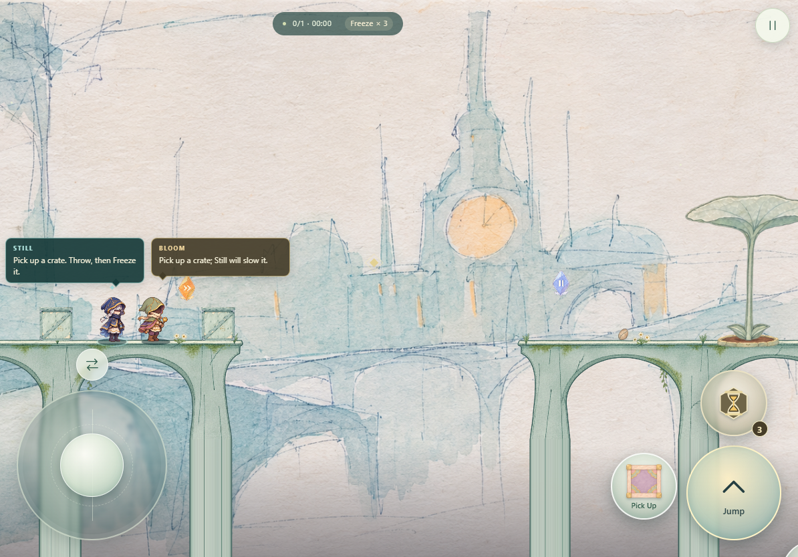
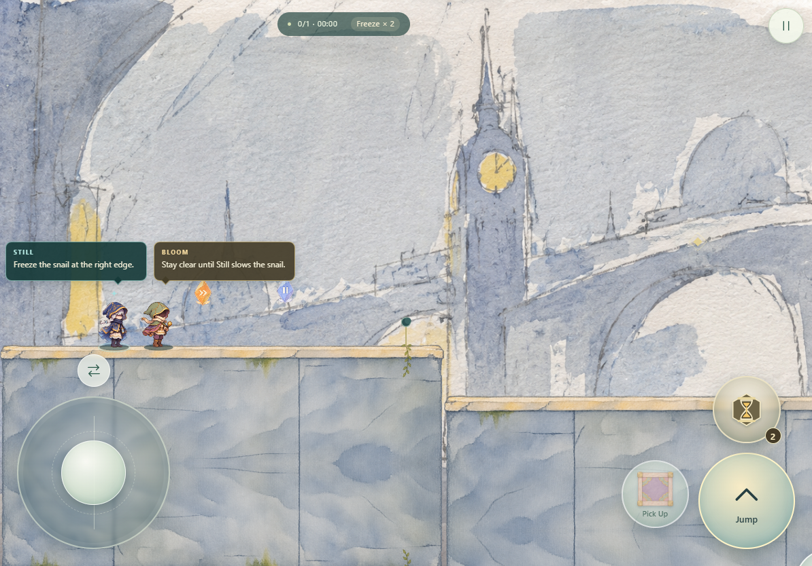
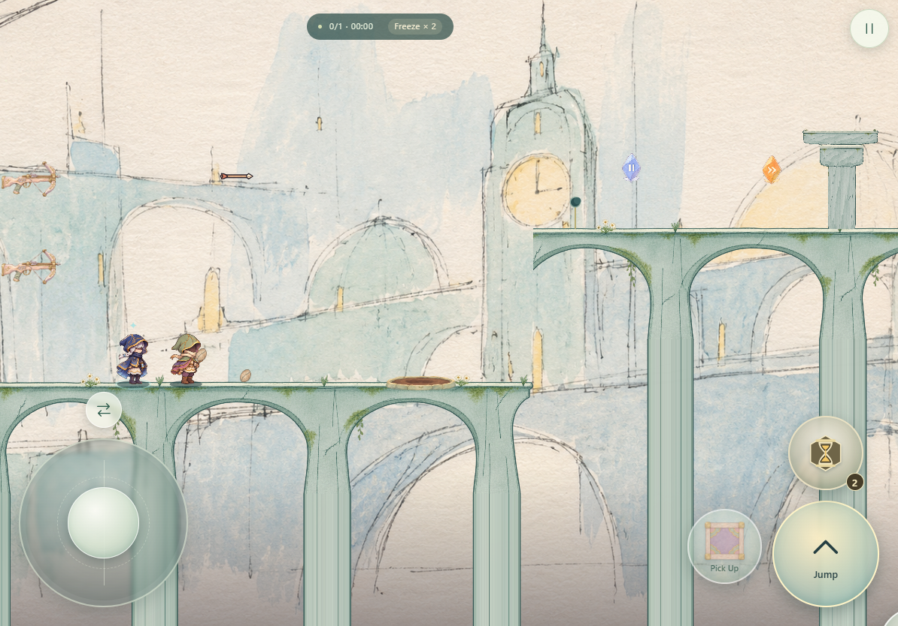
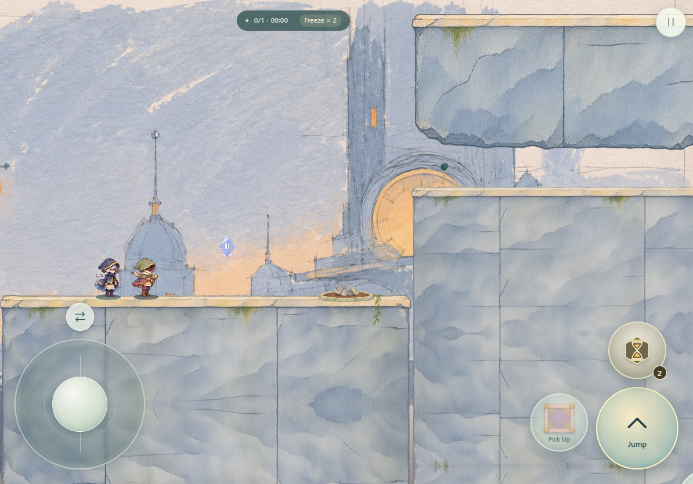
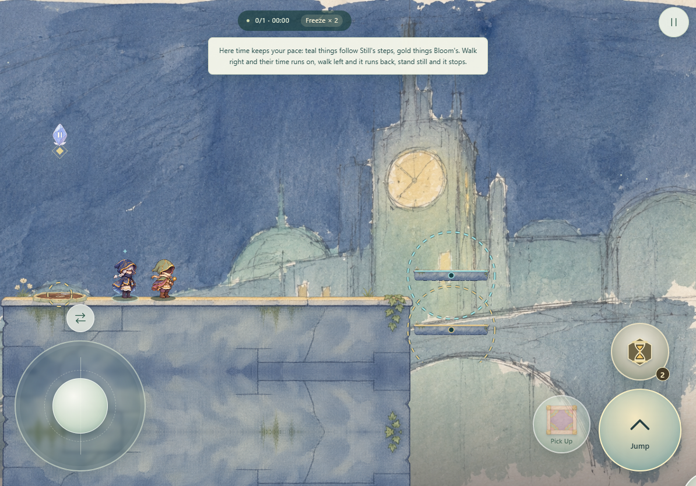

# Moonclock

> Two travelers, one borrowed moment.

Moonclock is a cooperative puzzle platformer with **two-player online co-op**. Travel through five courtyards as Still and Bloom, using their time powers to turn falling crates, growing plants, and passing clouds into a path to the moon gate.

## Play together online

Create a room, share its room code with a friend, and choose a different traveler each. Once both players are ready, the host starts your shared journey. Each player controls one character, and both see the same world and time effects. Solve each courtyard together and bring both travelers to the moon gate.

Solo play is also available. Switch between Still and Bloom to plan both sides of the puzzle yourself.

## Best experienced on mobile and tablets

Play in landscape for the best touch experience, especially on an iPad. Use the on-screen movement, jump, and interact controls, and drag to aim your abilities. Hold movement while jumping or casting to keep your timing precise.

You can play in a mobile browser or install Moonclock on your Home Screen. Desktop keyboard and mouse controls are supported too.

## Two travelers, two time powers

| Traveler | Ability |
| --- | --- |
| **Still** | Cast a Freeze Area to slow objects and mechanisms, and hold fully formed clouds in place. Create time to jump, land, and cross hazards. |
| **Bloom** | Wake an object's clock and hasten it up to 3× speed. Grow plants and set mechanisms in motion. In the rewind courtyard, turn time backwards instead. |

Carry and throw crates, collect and plant seeds, ride moving platforms, and find optional time shards. Every courtyard brings a different time puzzle, including plants that grow and wither, water that becomes a cloud, and objects that follow your footsteps.

## Five courtyards on iPad

All screenshots show the game in an iPad-sized landscape viewport with touch controls.

<table>
  <tr>
    <td width="50%" valign="top">
      <strong>01 · A Moment Held</strong> 
      
    </td>
    <td width="50%" valign="top">
      <strong>02 · Rising Rings</strong> 
      
    </td>
  </tr>
  <tr>
    <td width="50%" valign="top">
      <strong>03 · Past the Prime</strong> 
      
    </td>
    <td width="50%" valign="top">
      <strong>04 · Walking with Time</strong> 
      
    </td>
  </tr>
  <tr>
    <td width="50%" valign="top">
      <strong>05 · In Step with Time</strong> 
      
    </td>
    <td width="50%"></td>
  </tr>
</table>

## Credits

Created by our five-person Game Jam team:

- StephenYang
- Kehao Zhou
- Yihua Ren (Carol)
- Jeff Zhang
- Dorian Li
